# Semantic Database Firewall & Query Optimizer

A Python/FastAPI middleware that sits between an application and PostgreSQL.

It checks SQL for dangerous operations, analyzes allowed queries, caches repeated analysis, and can use an LLM to suggest query optimizations.

## Why I built it

Applications can send SQL that is:

- unsafe
- unnecessarily expensive
- repeatedly analyzed even when the query pattern is the same

This project puts a control layer in front of PostgreSQL.

The important design rule is:

> **The LLM is advisory. Deterministic code makes the security decision.**

## Architecture

```mermaid
flowchart LR
    Client --> API[FastAPI]
    API --> Parser[SQLGlot]
    Parser --> Security[Security Rules]
    Security --> Normalize[Normalize SQL]
    Normalize --> Redis[(Redis)]
    Redis --> Explain[PostgreSQL EXPLAIN]
    Explain --> Analyzer[Plan Analysis]
    Analyzer --> LLM[Optional LLM]
    LLM --> Validate[Validate Again]
    Validate --> Execute[Execute Approved Query]
```



## Tech Stack

- **Python 3.11+**
- **FastAPI / Uvicorn**
- **Pydantic**
- **PostgreSQL**
- **psycopg 3**
- **SQLGlot**
- **Redis**
- **Optional OpenAI-compatible LLM API**
- **pytest**
- **Docker / Docker Compose**

## How a request flows

```text
SQL request
    ↓
Parse SQL
    ↓
Security check
    ↓
Normalize query
    ↓
Redis cache
    ↓
EXPLAIN + plan analysis
    ↓
Optional LLM advice
    ↓
Validate any suggested SQL again
    ↓
Execute only if allowed
```

## 1. SQL parsing with SQLGlot

The SQL is parsed into an **AST (Abstract Syntax Tree)**.

This means the security layer can reason about the structure of the SQL instead of relying only on string matching.

It can detect things such as:

- multiple statements
- blocked operations
- writes when the system is in read-only mode
- dangerous functions
- restricted tables
- unfiltered updates/deletes

## 2. Deterministic security

Security decisions are made by explicit rules in the application.

The LLM cannot approve a dangerous query.

For example:

```text
SQL
 ↓
Security engine
 ↓
Blocked → stop
Allowed → continue
```

This makes the security behavior predictable and testable.

## 3. Redis caching

Before doing expensive query analysis, the system checks Redis.

The SQL is normalized so queries with the same structure can share cached analysis even when their literal values differ.

The benchmark achieved a **98.6% cache hit rate across 588 benchmark lookups**.

## 4. PostgreSQL EXPLAIN

For a cache miss, the project uses PostgreSQL `EXPLAIN (FORMAT JSON)` to inspect the query plan.

The plan analyzer can identify performance issues and produce recommendations such as potential index improvements.

## 5. LLM as an advisor

The LLM can explain query problems and suggest optimizations.

It is **not trusted with security**.

If it suggests different SQL, that SQL goes through the deterministic validation layer again before it can be executed.

```text
LLM suggestion
      ↓
Parse / validate
      ↓
Security rules
      ↓
Approved → execute
Rejected → do not execute
```

If the LLM is unavailable, the application has deterministic fallback behavior.

## Performance example

One benchmark measured a `users.email` lookup at:

```text
Before: 6.83 ms
After:  0.09 ms
```

That was approximately **75× faster in that benchmark**.

This is a project benchmark, not a claim about production performance.

## Testing

The repository contains automated tests for areas such as:

- SQL parsing
- security rules
- query handling
- caching
- optimization behavior
- middleware behavior

Benchmark scripts are also included for measuring cache and query performance.

## What is interesting about this project

The main idea is combining **traditional deterministic database engineering with AI without giving the AI control over security**.

The important pieces are:

**SQL AST parsing + deterministic security + Redis caching + PostgreSQL EXPLAIN + optional LLM optimization**

## Running locally

The repository includes Docker configuration and an `.env.example` file.

Do not commit real API keys, passwords, production connection strings, or private data.
